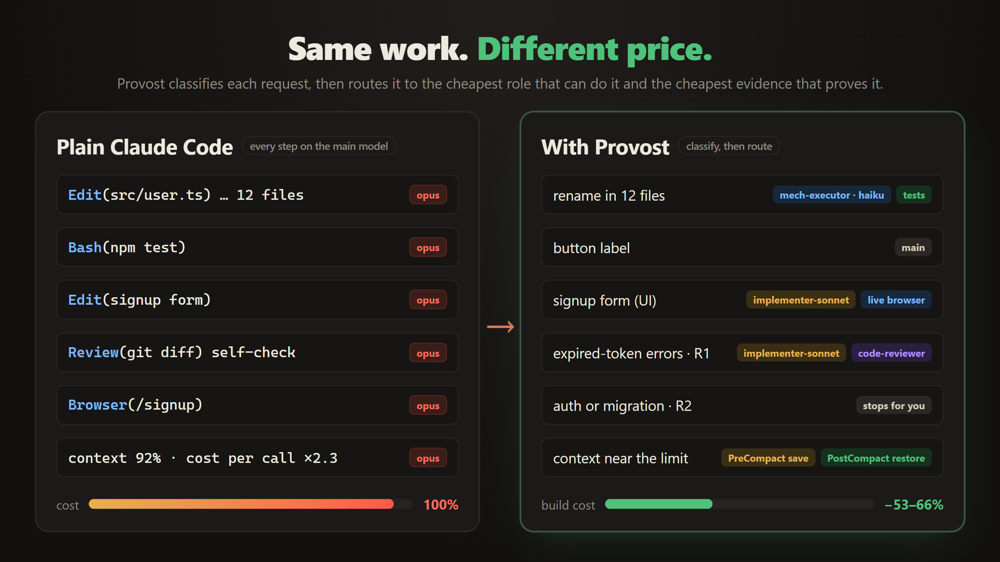

<p align="center">
  
</p>

<h1 align="center">Provost</h1>

<h3 align="center">Stop paying Opus prices for work that doesn't need Opus.</h3>

<p align="center">
  Provost makes Claude Code route each request to the cheapest model that can do it,<br>
  close it with evidence instead of "looks done", and keep its decisions through compaction.
</p>

<table align="center">
  <tr>
    <td align="center" width="220"><h2>−34%</h2>total spend<br><sub>10 days of real work</sub></td>
    <td align="center" width="220"><h2>−68%</h2>subagent cost<br><sub>vs. running them all on Opus</sub></td>
    <td align="center" width="220"><h2>0</h2>times re-explaining<br><sub>across 44 compactions</sub></td>
  </tr>
</table>

<p align="center"><sub>One user's measured work, not a controlled experiment. Windows, baselines and limits are under <a href="#evidence">Evidence</a>.</sub></p>

<p align="center">
  <a href="https://github.com/norton77930/Provost/actions/workflows/ci.yml"></a>
  
  <a href="LICENSE"></a>
</p>

<p align="center">
  <a href="#install"><b>Install</b></a> · <a href="#try-the-mods-first">Try the mods</a> · <a href="#how-it-works">How it works</a> · <a href="#evidence">Evidence</a> · <a href="README.zh-TW.md">繁體中文</a>
</p>

<p align="center">
  
</p>

<p align="center"><sub>A real session with Provost and the <a href="mods/board/">board</a> mod: the plan, who each step went to, and what still has to be proven before it counts as done.</sub></p>

## Three things it does

**1. Cheaper models do the typing.** The main session classifies every request
before it acts. A 12-file rename goes to Haiku, a bounded feature to Sonnet, a
one-line fix stays where it is. Over two weeks the main session wrote about 3%
of the changed code; the rest came from cheaper roles across 270 dispatches.

**2. "Done" needs proof.** Each claim is closed by the cheapest evidence that
would actually catch it failing: a test, a live run in the browser or CLI, or a
fresh-context reviewer when neither could. Acceptance gates are written before
the work starts, and the turn cannot end while a gate is pending or failed.
Changes to auth, secrets, payments or data migrations stop and wait for you.

**3. Decisions survive compaction.** Hooks save decisions, dispatches and
evidence before compaction and put them back after it, so early compaction is
safe. Context stays small, and each call stays cheap.

## What a request looks like

Work the way you always do. Before it acts, the main session declares how it
will handle the request (the line is written in your language; the notes on the
right are added here for this README):

```text
> Rename getUser to fetchUser in all 12 files
分類:機械/無風險/證據:測試 → mech-executor            # mechanical · no risk · tests close it → Haiku
> Add validation to the signup form
分類:中等/無風險/證據:實機(瀏覽器) → implementer-sonnet  # moderate · no risk · live browser check → Sonnet
> Handle expired tokens in the API client
分類:中等/R1(錯誤處理)/證據:審查 → implementer-sonnet    # error handling is invisible to a live run → code-reviewer after
> Add a role column to the users table
分類:困難/R2(migration)/證據:審查+架構 → 停,等你決定    # data migration: stops and asks you first
```

Here is the whole idea in 46 seconds:

https://github.com/user-attachments/assets/6e564d31-55b6-4271-a65d-1d8c1cebe413

<p align="center"><sub>46 seconds, English captions, music only. The Chinese version is in <a href="README.zh-TW.md">README.zh-TW.md</a>.</sub></p>

## Why not plain Claude Code?

Plain Claude Code is a strong agent. What it does not do on its own is decide
who does each step and what proves it is done, so every step runs on the main
model, and review happens when you remember to ask.

| When… | Plain Claude Code | With Provost |
| :--- | :--- | :--- |
| a rename touches 12 files | the main model edits each file | `mech-executor` on Haiku, closed by the tests |
| a bounded feature is ready | the main model writes it | `implementer-sonnet`: −53–66% build cost, same review outcomes |
| the change shows on screen | done when the code looks right | done after a live run in the browser, window or CLI |
| error handling, data conversion, concurrency | reviewed if you ask | `code-reviewer` in a fresh context, triggered by risk, never by diff size |
| auth, secrets, payments, migrations | proceeds like any other change | stops and waits for your decision |
| the context passes 400K | each call costs ~×2.3, compaction can drop decisions | compacts early; decisions are saved and restored |

<p align="center">
  
</p>

<p align="center"><sub>The build-cost bar compares <code>implementer-sonnet</code> with <code>implementer</code> on 34 trialled slices. Total spend fell 34% (see <a href="#evidence">Evidence</a>).</sub></p>

## Try the mods first

Two mods from this repo work on their own, without the rest of Provost. They
are the fastest way to see what it is about.

| Mod | What it does |
|---|---|
| [`board`](mods/board/) | A pane and status line for plan steps, subagent dispatches and acceptance gates (the screenshot above) |
| [`idle-guard`](mods/idle-guard/) | Compacts a large idle conversation before the one-hour prompt cache expires, so a late wake-up doesn't re-read the whole context |

```text
/plugin marketplace add norton77930/Provost
/plugin install board@provost
/plugin install idle-guard@provost
```

The UI is in English by default. Set a mod's `language` option to `zh-TW` in
`/config` for Traditional Chinese.

## Install

Requirements: Claude Code, Python 3.11+, and on Windows Git Bash (the hooks are
bash scripts).

```bash
git clone https://github.com/norton77930/Provost
python Provost/install.py setup
```

Then restart Claude Code and confirm with
`bash ~/.claude/provost/runtime/native-pilot-v1/hooks/runtime doctor`.

<details>
<summary><b>What setup changes, backups and upgrades</b></summary>

`setup` does everything an install needs, and `--dry-run` shows it first:

- copies the policy, roles, skills and runtime into `~/.claude` (the same as
  `install`);
- appends the `<!-- claudex-native:begin -->` / `<!-- claudex-native:end -->`
  markers to `~/.claude/CLAUDE.md` when it has none (the policy only ever goes
  between them, and a malformed pair is refused);
- adds the eight hook registrations below to `~/.claude/settings.json` when they
  are missing. Everything else in the file is kept, it is re-serialized with a
  2-space indent, and a file that is not valid JSON is refused. No value from it
  is ever printed;
- writes `~/.claude/provost/config.json` with handoff on when it does not exist.

Every changed file is backed up first to
`~/.claude/provost/backups/install-<UTC time>/` with a `manifest.json`, and a
failed run rolls back. Running `setup` again changes nothing. The first time it
replaces a local `skills/handoff/SKILL.md` that differs, it also keeps that copy
beside it as `SKILL.md.local-<UTC time>.bak`. The backup of `settings.json` is a
full copy, credentials included, and backups are never pruned. The installer
honours `CLAUDE_CONFIG_DIR` and `--config-dir`; the hooks themselves read
`~/.claude/provost/config.json` unless `PROVOST_CONFIG` points elsewhere.

After changing anything in the repository, run `python install.py check` to see
what differs from the live setup (exit 0 = no drift, 1 = drift), and
`python install.py install` to apply it; `install` never touches `settings.json`.
After upgrading to the decision log, run `migrate` and review it before
`migrate --apply` and any `prune --apply` (see the guide's
[Install and rollout](docs/native-handoff.md#install-and-rollout)).

</details>

<details>
<summary><b>What setup registers, to do it by hand</b></summary>

Replace `<runtime>` with the absolute path of
`~/.claude/provost/runtime/native-pilot-v1`:

```json
"hooks": {
  "SessionStart": [{"matcher": "startup|clear|compact|resume|fork", "hooks": [
    {"type": "command", "command": "bash \"<runtime>/hooks/native-event\"", "timeout": 30}]}],
  "PreCompact": [{"matcher": "manual|auto", "hooks": [
    {"type": "command", "command": "bash \"<runtime>/hooks/native-event\"", "timeout": 30}]}],
  "PostCompact": [{"matcher": "manual|auto", "hooks": [
    {"type": "command", "command": "bash \"<runtime>/hooks/native-event\"", "timeout": 30}]}],
  "PreToolUse": [{"matcher": "Agent", "hooks": [
    {"type": "command", "command": "bash \"<runtime>/hooks/acceptance-gate\"", "timeout": 30}]}],
  "PostToolUse": [{"matcher": "Edit|Write|NotebookEdit|Agent|Bash|PowerShell|EnterWorktree|ExitWorktree", "hooks": [
    {"type": "command", "command": "bash \"<runtime>/hooks/native-facts\"", "async": true, "timeout": 20}]}],
  "UserPromptSubmit": [{"hooks": [
    {"type": "command", "command": "bash \"<runtime>/hooks/native-facts\"", "timeout": 10}]}],
  "Stop": [{"hooks": [
    {"type": "command", "command": "bash \"<runtime>/hooks/native-event\"", "async": true, "timeout": 20}]},
    {"hooks": [
    {"type": "command", "command": "bash \"<runtime>/hooks/acceptance-gate\"", "timeout": 30}]}]
}
```

The `~/.claude/provost/config.json` it writes:

```json
{
  "schema_version": 1,
  "mode": "adaptive",
  "workspace_roots": [],
  "all_workspaces": true,
  "max_writers": 2,
  "burst_writers": 3,
  "handoff": true
}
```

`exclude_roots` (a list of directories) turns handoff off below them. See
[`docs/native-handoff.md`](docs/native-handoff.md) for storage, retention
and recovery.

</details>

## How it works

Provost has three parts: a policy the main session follows
([`native/CLAUDE.native.md`](native/CLAUDE.native.md)), nine subagent roles,
and a small runtime of hooks. Every non-trivial request starts with a one-line
declaration:

```text
分類:<simple|moderate|mechanical|hard> / <no-risk|R1|R2> / evidence:<test|live|review|architecture> → <route>
```

- **Difficulty decides who implements.** Simple work stays in the main session.
  Moderate slices go to `implementer-sonnet` (settled method, clear acceptance)
  or `implementer` (design choices left to the worker; `effort: high` for
  concurrency, lifecycle or security logic). Fully specified repetition
  goes to `mech-executor`. Hard work needs an approved spec first.
- **Risk decides which evidence closes a claim.** Pick the cheapest evidence that
  would catch the failure: a focused test, a live run, or, only when the failure
  is invisible to both, a `code-reviewer` (plus `architecture-reviewer` when an
  exposed interface changes). File count, diff size and "looks complex" are
  explicitly not reasons to review. A change that needs review is **R1**.
- **R2 stops.** Auth, secrets, payments, migrations, breaking public APIs,
  cross-repo or irreversible operations wait for the user's decision, and are
  done only after review.
- **Acceptance gates hold the turn.** Before the work starts, the session writes
  its gates (`machine`, `live`, `visual`, `review`, `human`) to
  `.claude/acceptance/<task>.json`. A Stop hook pushes back while a non-human
  gate is pending, failed or stale, and a visual gate is judged against its
  mockup by `acceptance-verifier`, not by the session that did the work.
- **Writers are budgeted.** Normally at most two concurrent writers, three when
  the third is provably independent; ownership of files and shared resources is
  checked before every wave.
- **Completion is finite.** Once every claim passes, only the planned final
  verification runs. No extra review, tests or refactoring after that.

### Roles

| Role | Model | Effort | Tools | Used for |
|---|---|---|---|---|
| `Explore` | haiku | high | Read, Glob, Grep | Read-only reconnaissance |
| `mech-executor` | haiku | high | + Write, Edit, Bash | Fully specified mechanical batches |
| `test-analyst` | haiku | medium | Read, Glob, Grep, Bash | Running existing tests, regression analysis |
| `implementer-sonnet` | sonnet | high | + Write, Edit, Bash | Default implementer for settled, bounded slices (TDD) |
| `implementer` | opus | medium | + Write, Edit, Bash | Slices with real design choices; dispatched at `high` for hard ones |
| `general-purpose` | sonnet | high | all but Agent | Bounded non-code work no other role fits |
| `code-reviewer` | fable | high | Read, Glob, Grep | Risk-triggered fresh-context review of a declared claim |
| `acceptance-verifier` | sonnet | high | Read, Glob | Judging visual, live and threshold gates against their source; reports PASS, ISSUES or BLOCKED |
| `architecture-reviewer` | fable | high | Read, Glob, Grep | Review when an exposed interface or boundary changes |

Reviewers fall back to `opus` only when a run fails with an explicit Fable quota
error.

### Handoff runtime

The runtime keeps a sealed, per-session chain of handoff records (sources,
decisions, assignments, evidence, next step) under
`~/.claude/provost/handoffs`, shared by a checkout and its worktrees. Hooks
inject the latest checkpoint after compaction or resume, capture facts (edited
paths, dispatches, commits; never command text or file contents) and remind the
main session when a dispatch or edit has no record yet. Decisions and evidence go
to an append-only log per work, shared by every session of the repository.
Commands: `doctor`, `status`, `record`, `snapshot`, `list`, `resume`, `changes`,
`search`, `prune`, `migrate`, and the maintainer-only `redact`.
See [`docs/native-handoff.md`](docs/native-handoff.md).

### What is in the repository

| Path | What it is | Installed to (in `~/.claude`) |
|---|---|---|
| [`native/CLAUDE.native.md`](native/CLAUDE.native.md) | The orchestration policy | between the `claudex-native` markers in `CLAUDE.md` |
| [`agents/`](agents/) | Nine subagent roles | `agents/` |
| [`hooks/`](hooks/), [`scripts/provost_runtime/`](scripts/provost_runtime/) | Handoff runtime and its hooks | `provost/runtime/native-pilot-v1/` |
| [`skills/verification-before-completion/`](skills/verification-before-completion/) | Completion-claim discipline | `skills/` |
| [`skills/handoff/`](skills/handoff/) | The `/handoff` skill (save, resume, search) | `skills/handoff/` |
| [`tools/dispatch-report.js`](tools/dispatch-report.js) | Cost and outcome report of past dispatches, from transcripts | `experiments/` |
| [`mods/`](mods/) | The `board` and `idle-guard` plugins | installed with `/plugin` |
| [`install.py`](install.py) | Installer and read-only drift check | — |

Methodology skills (TDD, diagnosis, grilling, spec and tickets) come from the
[`mattpocock-skills`](https://github.com/mattpocock/skills) plugin, which the
policy refers to by name.

## Evidence

One user, real work, measured from Claude Code transcripts. Not a controlled
experiment.

- **Total spend −34% to −36%** over 10 days (2026-10-14 to 10-23), priced
  against the same transcripts with the default compaction window and every
  subagent role one model up (Sonnet for the Haiku roles, Opus for
  `implementer-sonnet`). Reviewers were 7.7% of the spend.
- **Subagents −68%** against an all-Opus baseline over the same 10 days:
  implementation −50%, exploration −88%, tests and batches −97%.
- **Main session −45.6%** from compacting earlier ($980 against $1,802 at the
  default window, same 10 days). The handoff hooks are what make early
  compaction safe, so this is the setting and the hooks together.
- **`implementer-sonnet` −53–66%** against `implementer` on 34 slices across 5
  repositories, including paired runs on the same brief, with equal review
  outcomes. It became the default implementer on 2026-10-04.
- **Main session wrote about 3%** of changed code lines over two weeks
  (2026-09-28 to 10-12, 84 sessions); implementer roles wrote the rest across
  270 dispatches.
- **No re-explaining:** across 44 compactions, no session needed the user to
  re-explain lost context.
- **Reviews were earned:** 92% of `code-reviewer` dispatches had a genuine risk
  trigger (79 of 86, audited over the same 10 days).
- **Overhead:** the hook mechanism cost about 3% of total spend.

## Known limitations

- Tuned for one person's daily work and published as it is used: Windows first,
  installed by copying files into the Claude config directory with a drift
  check.
- Model aliases (`fable`, `opus`, `sonnet`, `haiku`) resolve to whatever your
  Claude Code version maps them to.
- Hooks spawn bash and Python on every call; on Windows that costs roughly a
  second per hook.

## Tests

```bash
python -m unittest discover -s tests/adaptive -p "test_*.py"
```

CI runs the suite on Windows, Ubuntu and macOS, tests the mods, and checks
Markdown links.

## Contributing

See [CONTRIBUTING.md](CONTRIBUTING.md). Release notes are in [CHANGELOG.md](CHANGELOG.md); plans in [ROADMAP.md](ROADMAP.md). Ideas and bug reports go in [issues](https://github.com/norton77930/Provost/issues/new/choose). Security reports: [SECURITY.md](SECURITY.md).

Provost started as a three-tier governance framework shipped as a Claude Code
plugin. That design is archived at tag
[`archive/tier2-foreman`](https://github.com/norton77930/Provost/tree/archive/tier2-foreman)
and is no longer maintained.

## License

[MIT](LICENSE). Copyright (c) 2026 Norton. Third-party skill attribution is in
[`skills/NOTICE.md`](skills/NOTICE.md).
