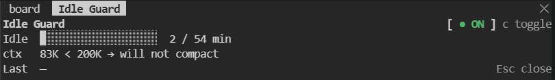

# idle-guard

Compacts the main conversation after it has been idle for a while (54 minutes by default), so a late wake-up rewrites a short summary instead of the whole context. It waits 30 seconds longer than the built-in idle compaction so the built-in one goes first, and skips compaction when the context is already small or the idle time has passed the one-hour prompt-cache lifetime. Run `/idle-guard` to open a small pane with the idle timer and an on/off switch.



The status line and the pane as text:

```
idle-guard  compact ● ON · compacts in 32 min       (status line)

Idle Guard                          [ ● ON ] c toggle
Idle  ████████░░░░░░░░░░░  22 / 54 min
ctx   312K ≥ 200K → will compact when idle
Last  —                                   Esc close
```

## Install

```
/plugin marketplace add norton77930/Provost
/plugin install idle-guard@provost
```

## Settings

Change these with `/config`, or `/plugin` → Installed → idle-guard → Configure options. If you load the plugin from a directory (`--plugin-dir` or `CLAUDE_CODE_PLUGIN_DIRS`), `/config` stores them in `settings.json` under `pluginConfigs` → `idle-guard@inline` → `options`.

| Key | Default | Meaning |
| --- | --- | --- |
| `minutes` | `54` | Idle minutes before compacting; 30 seconds are added so the built-in idle compaction goes first. |
| `minTokens` | `200000` | Compact only when the live context holds at least this many tokens. |
| `language` | `en` | UI language: `en` (English) or `zh-TW` (繁體中文). Any other value shows English. |

## Development

```
claude plugin test mods/idle-guard
```
